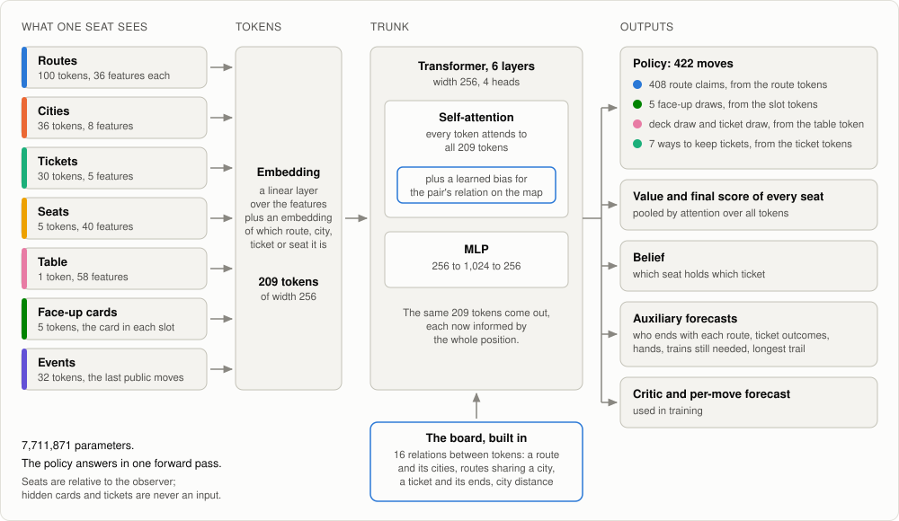
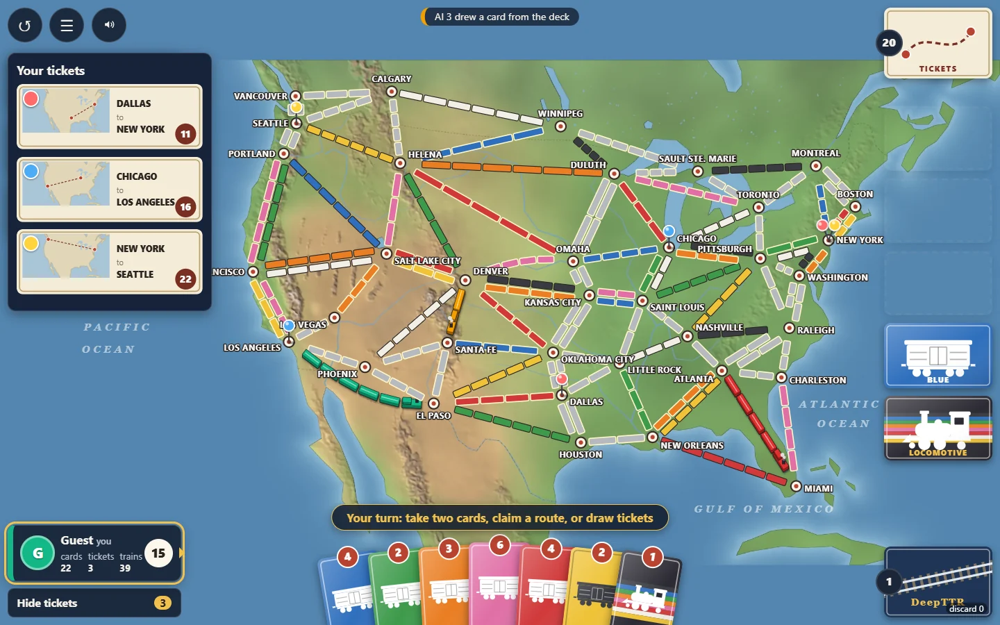

# DeepTTR

DeepTTR is a neural network that plays the board game Ticket to Ride: the base game on the full
USA map, by the official rules, at tables of two to five players. It was trained by deep
reinforcement learning, from its own games and without a single human one. It is a transformer
with 7.7 million parameters that sees only what a player in its seat sees, and no hand-written
strategy takes part in its play. Its policy alone picks a move in one forward pass. Against a
person, on a machine with a GPU, it also looks ahead: it plays its best candidate moves out to the
end of the game in sampled deals of the hidden cards, and gives up its first choice only for a
move the look-ahead has proved better.

Ticket to Ride is a game of hidden information and long plans. A player holds secret destination
tickets, collects cards for dozens of turns, and has to join the cities of several tickets into
one network of routes before the other players cut it. Earlier work on the full game ended at
scripted and search-based players. The strongest strategy it reports does not play that game at
all: it hoards cards, takes the longest routes and ignores its tickets. Learning agents were shown
only on reduced maps ([related work](docs/related-work.md)). The aim of this project was a
different level of play: a network that learns the whole game. A card hoarder now stands more than
300 Elo points below it, near the bottom of the project's rating table.

Three ideas carry the training:

- A curriculum of skills. Training runs in eleven phases. Each phase teaches one skill, starts from
  the network the previous phase ended with, and ends when its skill is measured as learned.
- A league and a championship. The network learns by proximal policy optimization against frozen
  opponents: scripted bots and its own earlier versions. In the championship it meets eleven of them
  at once, the harder the more often, and every network is rated on one Elo scale.
- A limited Monte Carlo search. Candidate moves are played out to the end of the game in sampled
  hidden worlds. In training a move proved better than the network's own choice becomes a lesson
  for the policy; at the table it is the move played.

## Contents

- [The network](#the-network)
- [Training](#training)
- [Results](#results)
- [Play against it](#play-against-it)
- [Training charts](#training-charts)
- [Layout](#layout)
- [License and trademark](#license-and-trademark)

## The network



Every route, city, destination ticket and seat is a token, and so are the table, the face-up cards
and the last public moves. The board is built into the attention: each head learns a bias for
every kind of relation two tokens can have on the map, so each layer works on the graph of the
board and not on a flat list. Each output is read from the tokens it is about: the logit of a
claim comes from the token of its route, the logit of a ticket choice from the tokens of the
tickets.

| | |
|---|---|
| Input | 209 tokens: 100 routes, 36 cities, 30 tickets, 5 seats, the table, 5 face-up cards, the last 32 public events |
| Features per token | 36 a route, 8 a city, 5 a ticket, 40 a seat, 58 the table |
| Trunk | 6 transformer layers, width 256, 4 attention heads, MLP of 1,024 |
| The board in the attention | 16 relations between tokens, one learned bias per head and relation |
| Policy | 422 moves: 408 route claims, 5 face-up draws, the deck draw, the ticket draw, 7 ways to keep tickets |
| Other outputs | value and final score of every seat, a belief over who holds which ticket, five auxiliary forecasts, a critic and a forecast for every move |
| Parameters | 7,711,871 |
| A move | the first choice of the policy, one forward pass; on a GPU the play server adds the look-ahead |
| Hidden information | none in the input: the observation is what the seat sees, and a test checks that nothing else leaks into it |

[docs/architecture.md](docs/architecture.md) has the moves, the observation and every output in
full.

## Training

The reward for a ticket arrives dozens of turns after the choices that earn it. The first four
phases therefore teach the building blocks of the game one at a time, under scoring reduced to the
skill in question, and return the full rules step by step. From the fifth phase on the rules are
the official ones and the task is to win.

| Phase | Skill | How it is taught |
|---|---|---|
| 1 | Completing a ticket | Two players, only tickets score. The network imitates a scripted teacher that values a move by what it adds to the path of a ticket. |
| 2 | One network of routes for all tickets; which tickets to keep | The teacher now plans one path through the cities of all the tickets. The choice of tickets is learned from playouts of every option to the end of the game. |
| 3 | Every table size | No teacher from here on. The network plays itself at tables of two to five and imitates its own games that scored above the average of their table. |
| 4 | The full scoring | Route points are phased in from 0 to 100 %. At the end the rules are the official ones. |
| 5 | Beating the scripted bots | Proximal policy optimization with a learned critic, against a ticket builder, a card hoarder and the network of phase 4. |
| 6, 7 | Beating its ancestors | The league: the opponents are the frozen networks from the ends of the phases before. |
| 8 | Scoring high | The league, with a bonus in the reward for the network's own score and for completed tickets. |
| 9 | The championship | Eleven opponents at once, both bots and nine frozen networks, each met the more often the harder it is. Every network is rated on one Elo scale. |
| 10 | Seeing further | The championship with the look-ahead teacher: lessons only from moves that the look-ahead has proved. |
| 11 | Real tables | At tables of three to five every other seat is a different opponent of the league, and the look-ahead teacher plays against the league as well. |

In the league every deal is played once from each seat, on the same cards and tickets, so the luck
of the deal cancels. The reward of a move is the margin of its seat over the strongest opponent at
the table, made zero-sum over the seats. In the championship the share of games against an opponent
follows (1 - w)², where w is the share of games the network currently wins against it at that
table size: it meets most the opponents it loses to. Ratings come from duplicate matches fitted
with a Bradley-Terry model ([docs/evaluation.md](docs/evaluation.md)).

In the last two phases a share of the games belongs to the look-ahead teacher. In them every
choice of tickets and up to a tenth of the other decisions are checked. The engine deals the
hidden cards and tickets again, consistently with everything the seat has seen, and plays the
network's first choice and its best alternatives out to the end of the game in eight such deals.
An alternative that comes out ahead is tried again on 24 fresh deals, and becomes a lesson only if
it is still better by three points and by two standard errors. The lessons distil the look-ahead
into the policy.

This is a Monte Carlo search without a tree: the only branching is at the decision itself, and
every line below it is a whole game played by the policy. The second phase used an earlier,
simpler form of the same idea to learn which tickets to keep: 32 playouts of every choice, and the
choice that brought the most points from tickets became the lesson. No phase used a tree search.
Against a person the play server runs the two-stage look-ahead of the last phases, within eight
seconds a move.

In all, training took 8.8 million games and 658 million decisions.

The recipes of the eleven phases are in the repository, a file a phase. [Training
charts](#training-charts) shows how to run them and follow the run on a page of charts;
[docs/training.md](docs/training.md) has the charts of the run that made the published network and
says where the recipes differ from it.

## Results

The network learned the skills the phases were built to teach.

It builds tickets. Over 400 games at a table of two against the card hoarder it ends a game
holding 6.3 tickets and has completed 5.1 of them, for 55 points from tickets a game.

It decides how many tickets to take. Beyond its starting tickets it draws new ones three times a
game on average.

It joins its tickets into one efficient network of routes. Its longest continuous trail takes 30
of the 39 trains it places, and it ends with the longest trail in 96 % of games.

Against people it plays at the level of a very strong human player.

One skill did not last. A critical route is a short link that a ticket cannot do without and that
an opponent can take first. A dedicated phase teaches the network to claim such routes at the
first opportunity: the share of them claimed at once rises from about 15 % to over 90 %. In the
training that follows the habit fades again, to about half within a few hours and falling. Only the
claims of a few short links stay.

## Play against it



The surest test of its strength is to play it. You need Python 3.11 or newer and a
[Rust toolchain](https://rustup.rs); on Windows its installer also asks for the Visual Studio C++
build tools. No GPU is required: the network runs on a CUDA card if there is one, else on Apple's
MPS, else on the CPU.

On Windows, in PowerShell:

```powershell
git clone https://github.com/ivan-gorbadei/DeepTTR
cd DeepTTR
python -m venv .venv
.venv\Scripts\python -m pip install torch
.venv\Scripts\python -m pip install -e .
.venv\Scripts\python -m deepttr.serve
```

On Linux or macOS, in a terminal:

```sh
git clone https://github.com/ivan-gorbadei/DeepTTR
cd DeepTTR
python3 -m venv .venv
.venv/bin/python -m pip install torch
.venv/bin/python -m pip install -e .
.venv/bin/python -m deepttr.serve
```

Then open http://127.0.0.1:8080/ in a browser. Every command runs the Python of the new
environment `.venv` by its path, so the environment never has to be activated. The server plays
the trained network that comes with the package (`python/deepttr/weights/deepttr.pt`). The line
`pip install -e .` compiles the engine and installs the package with all it needs; it takes a
minute or two.

On Windows the plain `pip install torch` gives a build for the CPU. With an NVIDIA card, use this
line in its place, with the index that [pytorch.org](https://pytorch.org/get-started/locally/)
gives for your driver:

```powershell
.venv\Scripts\python -m pip install torch --index-url https://download.pytorch.org/whl/cu132
```

If the CPU build is installed already, add `--force-reinstall` to that line.

A game is for two to five players by the official rules: you choose how many before it starts,
and the network plays every other seat. Each of its moves is played out on the board in turn,
with a sound, and it sees what you would see in its seat and nothing else. Your tickets stand on
the map as pins, one colour a ticket. With a GPU the network looks ahead before every move, a
second or two on a fast card. On a CPU it answers at once with its first choice; `--look-worlds 8`
turns the look-ahead on there for those who will wait.

With `--record games` the server keeps every finished game, with the player's consent. A recorded
game holds every move and replays exactly, so a series of games against people can be measured
afterwards.

To run the tests, install the package with `-e ".[test]"` in place of `-e .`, then run
`python -m pytest` with the same Python.

## Training charts

The eleven phases of the training run in order with one command, in the folder of the clone and
with the environment of [Play against it](#play-against-it). A second command, in another window,
serves the charts of the run while it goes on and after it.

On Windows, in PowerShell:

```powershell
.venv\Scripts\python -m deepttr.curriculum runs/one
.venv\Scripts\python -m deepttr.charts runs/one
```

On Linux or macOS, in a terminal:

```sh
.venv/bin/python -m deepttr.curriculum runs/one
.venv/bin/python -m deepttr.charts runs/one
```

Then open http://127.0.0.1:8090/ in a browser. The page draws every phase's measures against the
training games, steps or hours: the skill the phase teaches, its wins against each opponent at each
table size, the scores, the critic, the pace. It has smoothing, zoom, a crosshair across the charts,
95 % intervals, a log scale, and each chart's numbers as CSV and its picture as PNG or SVG. It reads
the run's files again whenever they change, so it follows a run under way. For a run on another
machine, start the page there with `--host 0.0.0.0` and open it by that machine's address.

A phase trains on every CUDA card of the machine: on each a worker plays the games, and the first
also holds the trainer. Without one it trains on Apple's MPS or on the CPU, far more slowly. A file
`STOP` in the folder of the phase under way stops the run with its network saved, and the same
command goes on from there. `--check 200` trains every phase for 200 steps only, a test of the
whole line. After the last phase, `python -m deepttr.championship runs/one` rates the ends of the
phases and the two bots on one Elo scale, and the page shows the ratings too.
`python -m deepttr.charts.export runs/one OUT` writes the charts as SVG files.

## Layout

```
engine/core/       the rules engine in Rust: map, state and rules, observation, bots, matches,
                   the look-ahead, self-play for training and the scripted teacher
engine/python/     the engine as a Python module, deepttr._engine
data/maps/usa/     the board: cities, routes, tickets, city coordinates
python/deepttr/    net.py (the network), look.py (the look-ahead), play.py (the duplicate match),
                   match.py, versus.py, elo.py (the rating scale), serve.py and web/ (the play
                   server), weights/ (the trained network)
                   train/ (the trainer and its self-play workers), recipes/ (the eleven phases),
                   curriculum.py (the phases in order), measure.py (the measures of strength),
                   championship.py (the ratings of a run), charts/ (the page of a run's charts)
tests/             pytest; the engine's own tests run with cargo test -p deepttr-core in engine/
docs/              architecture.md, evaluation.md, related-work.md, training.md
```

[docs/architecture.md](docs/architecture.md) describes the moves, the observation and the network.
[docs/evaluation.md](docs/evaluation.md) describes the duplicate match, the baselines, the rating
scale and the rules as implemented. [docs/related-work.md](docs/related-work.md) lists earlier
Ticket to Ride agents.

## License and trademark

The code is under the [MIT License](LICENSE). [CITATION.cff](CITATION.cff) says how to cite it.

Ticket to Ride is a trademark of Days of Wonder, Inc. DeepTTR is an unofficial research project. It
is not affiliated with, endorsed or sponsored by the game's publisher, and it contains no artwork or
text of the published game. The board is stored as a graph; the map, the cards and the pieces on
the page are drawn for this project, the map from the cities' geographic coordinates with a
stylized relief.
