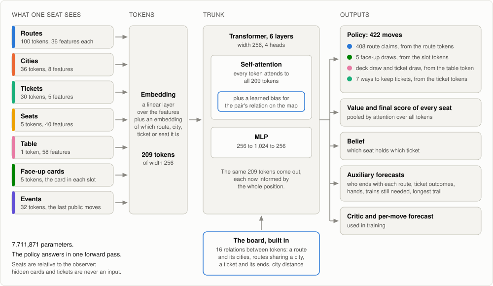

# Architecture

The project has three parts. The engine (`engine/core`, Rust) holds the rules of the game, the
observation each seat gets of a position, the baseline bots and the match runner. The network
(`python/deepttr/net.py`, PyTorch) reads one observation and returns a policy over the moves and a
set of forecasts. The tools in `python/deepttr` run duplicate matches, fit a rating scale and serve
a page to play on.

A match runs hundreds of games in step. The engine plays every game on until a network has to
choose, hands over all the waiting positions as one batch, and plays each position's move when the
logits come back. Bots' moves, forced moves and passes never leave the engine.

## The moves

Every move of the game has a fixed action id, 422 in all.

| Ids | Count | Move |
|---|---|---|
| 0 to 407 | 408 | claim a route with cards of a colour: one action for each of the 56 coloured routes, eight (one per colour) for each of the 44 grey routes |
| 408 to 412 | 5 | take the card in a face-up slot |
| 413 | 1 | draw a card from the deck |
| 414 | 1 | draw destination tickets |
| 415 to 421 | 7 | keep a subset of the three tickets on offer (the seven non-empty subsets) |

A claim is always paid with as few locomotives as possible, so the colour is the whole choice.
Taking two cards is two decisions: the second card is a move of its own.

## The observation

The network gets what a person in that seat sees at the table: the board, the face-up cards, the
discard pile, every player's public counts, its own hand and tickets. Other players' hands and
tickets are hidden, and so is what they kept at the start until everybody has chosen. Seats are
relative to the observer: seat 0 is the observer, seat 1 the next to act.

| Tokens | Count | Features of each |
|---|---|---|
| Route | 100 | 36: who holds it, closed double, barred to me (I hold its twin), affordable now, cards I am short, length, colour, points, the turn it was claimed in, the colour and the locomotives that paid for it |
| City | 36 | 8: routes there per seat, ends of my tickets, of tickets on offer to me, of my completed tickets |
| Ticket | 30 | 5: mine, on offer to me, neither, completed by me, points |
| Seat | 5 | 40: present, to act, trains, route points, cards and tickets in hand, the cards it is known to hold (taken face up and not yet spent), draws from the deck and from the face-up row, ticket draws and tickets kept, longest trail and whether it is the longest, cards taken face up and cards paid by type over the whole game |
| Table | 1 | 58: the game's phase, last round and turns left, deck and discard pile, my hand, the face-up cards by type, the ticket choice under way, the turn, the number of players, the rules in force |
| Face-up slot | 5 | the card in the slot |
| Event | 32 | the last 32 public events, oldest first: kind, seat, card or colour, route, a count |

That is 209 tokens. The exact layout is at the constants of
[`engine/core/src/obs.rs`](../engine/core/src/obs.rs). When an event leaves the window of 32
nothing public is lost: every claim stays on its route (turn, colour, locomotives) and every draw
stays in its seat's counts.

That nothing hidden leaks is tested. For random positions of games at every table size the engine
deals the hidden cards and tickets again, consistently with what one seat sees, and that seat's
observation must come out identical (`sample::tests::sampled_worlds_look_the_same`).

The rules in force are part of the observation because the engine can also play training variants
of the game, listed in [evaluation.md](evaluation.md#the-rules-as-implemented). In the official
game those inputs are constant.

## The network

### Tokens

A route, city, ticket or seat token is a linear layer over its features plus an embedding of which
route, city, ticket or seat it is. A slot token embeds its card and its position. An event token
sums embeddings of its five fields and of its position in the window.

### The map in the attention

Every pair of tokens has one of 16 relation types, fixed by the map: a route and one of its cities,
two routes that share a city, the two routes of a double, a ticket and one of its end cities, a
ticket and a route at one of its ends, two tickets that share an end, two cities at a distance of
1, 2, ... 8 or more routes, a token and itself, and no relation. Each attention head learns one
bias per relation type and adds it to the attention scores in every layer. The network therefore
works on the graph of the board, not on a flat list of 209 items (`relation_matrix` in `net.py`).

### Trunk and heads

The trunk is six pre-norm transformer layers of width 256, with four heads and a fourfold MLP. Each
head reads the tokens it is about.

| Output | Shape | Meaning |
|---|---|---|
| `logits` | 422 | the policy. A claim reads its route's token, the colour paid and the table token; a face-up draw reads its slot's token; the deck and ticket draws read the table token; a keep mask sums the scores of the tickets it keeps. Illegal moves are masked |
| `value` | 5 | expected utility per seat: +1 first place, -1 last |
| `score` | 5 | expected final score per seat, in hundreds of points |
| `belief` | 5 x 30 | per seat and ticket, the logit that the seat holds the ticket |
| `owner` | 100 x 6 | who holds each route at the end of the game: nobody or a seat |
| `ticket` | 30 x 3 | each ticket's outcome for the observer: not held, completed, failed |
| `hand` | 5 x 9 | each seat's cards by type |
| `path` | 5 x 30 x 2 | per seat and ticket: the trains still needed to join the ticket's cities, and whether it can still be done |
| `trail` | 5 x 2 | per seat: whether it ends with the longest trail, and the trail's length |
| `adv` | 1 | the critic: the expected reward of the game for the seat to act, in hundreds of points |
| `move` | 422 | per move, a forecast of the margin over the best other seat that the seat to act ends with after it |

The value and score heads pool every token by attention before reading (`OutcomeHead`). The outcome
of a game is spread over the board, and the table token alone does not carry it.

The network has 7,711,871 parameters. Earlier networks of the training differ only in their heads,
and `NetConfig` builds them too: value and score read from the table token alone (5,342,325
parameters), then pooled over all tokens (6,790,261), then with the critic (7,579,254), then with
the move forecast (7,711,871).

## Choosing a move

The policy's first choice is the legal move with the highest logit. It costs one forward pass and
involves no sampling, so on a given device the policy alone is a deterministic player. Every match
in [evaluation.md](evaluation.md) is played this way.

Devices differ slightly. On a CUDA card the network runs in bfloat16, elsewhere in float32. On
3,044 recorded positions the two picked a different move in 8 (0.26 %). Results in this repository
say which was used.

### The look-ahead

When the network plays a person, the play server checks the first choice by looking ahead
(`engine/core/src/look.rs`, `python/deepttr/look.py`). It does so on a GPU; on a CPU a look
seldom ends within the time for a move, and the server plays the first choice unless asked. The
teacher of the last training phases works by the same routine, with one difference: there the
copies are played by samples of the policy, here by its first choice.

1. The candidates are the first choice, the best move of each other kind (a claim, a card,
   drawing tickets), and then the next moves in the policy's order, four at most. At a choice of
   tickets they are every set on offer when there are four or fewer, as at the start of a game,
   else the policy's best three.
2. The position is copied into eight hidden worlds. In each the cards and tickets the seat cannot
   see are dealt afresh, consistently with everything it has seen (`sample.rs`). In every world
   each candidate is played, and the rest of the game is played by the policy's first choice at
   every seat. The copies of one world share its cards and its luck, so the candidates are compared
   on the same deals.
3. If another candidate ends with a larger mean margin over the best opponent than the first
   choice, the two are played again in 24 fresh worlds. The other move is played only if it is
   better there by at least three points and by two standard errors of the paired differences.
4. If the time for a move runs out, the first choice is played.

This is a Monte Carlo search of depth one over deals of the hidden information. It builds no tree:
below the candidate every seat follows the policy to the end of the game.
