# Training

The network was trained in eleven phases. Each phase teaches one skill, starts from the network the
phase before it ended with, and ends by a rule that measures its skill or after a set number of
steps. The recipes of the phases are in `python/deepttr/recipes`, one file a phase, and one command
runs them in order:

```sh
python -m deepttr.curriculum runs/one
```

The run's folder gets a folder for each phase: the trainer's log, the networks it saves every 2,000
steps, the measures of their strength, and the phase's record once it ends. A file `STOP` in the
folder of the phase under way stops the run, its network saved, and the same command goes on from
where it stopped. A phase uses every CUDA card of the machine, a worker playing games on each and
the trainer on the first; without one it runs on Apple's MPS or on the CPU, far more slowly. `--check 200`
trains every phase for 200 steps only, a test of the recipes.

The charts of every phase are on a local page while the run goes on and after it:

```sh
python -m deepttr.charts runs/one
```

The page draws each phase's measures against the training games, steps or hours, with smoothing,
zoom, a crosshair across the charts, 95 % intervals and the data of every chart for download. For a
run on another machine, start the page there with `--host 0.0.0.0` and open it by that machine's
address. `python -m deepttr.charts.export runs/one OUT` writes the charts as SVG files. Those below
are the charts of the run that made the published network.

## The phases

### 1. Completing a ticket

Two players, and only tickets score: a ticket left unfinished scores the share of its shortest path
that is built. The network imitates a scripted teacher that values each move by what it adds to the
path of one of its tickets. The phase ends when the players complete 97.5 % of the tickets they keep
at the start; at its first training line they completed 22 %.

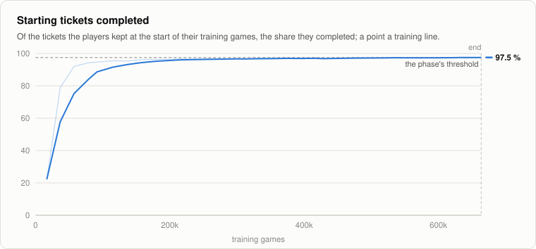

### 2. One network of routes for all tickets; which tickets to keep

The teacher now plans one set of routes through the cities of all the open tickets, so that a route
several tickets share pays for each of them, and a failed ticket costs its points. Every choice of
tickets stops its game and is played out from each of its options in 32 copies, the hidden cards
dealt afresh; the option whose tickets score most on average is the lesson. On 1,024 fixed deals
the ticket points of the network's first choice rose from 41.5 to 74.3 a seat.

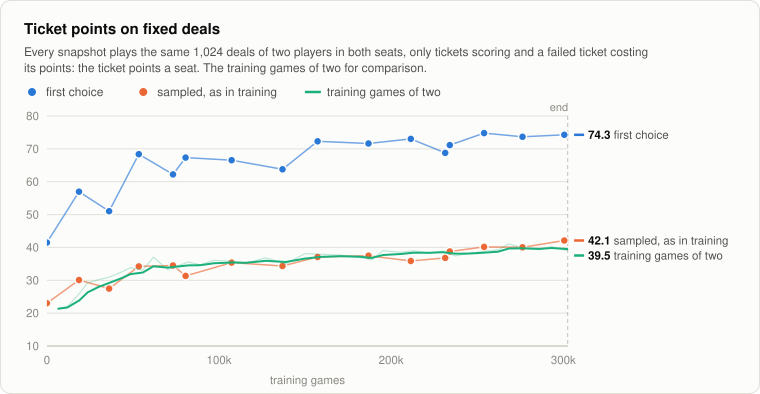

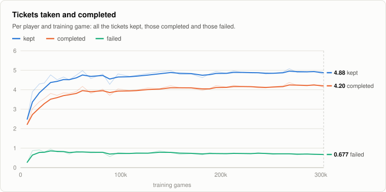

### 3. Every table size

No teacher from here on. The network plays itself at tables of two to five players and learns from
the moves of its own games, each weighted by how far its player's final score stands above the
average at that table size. Only tickets score.

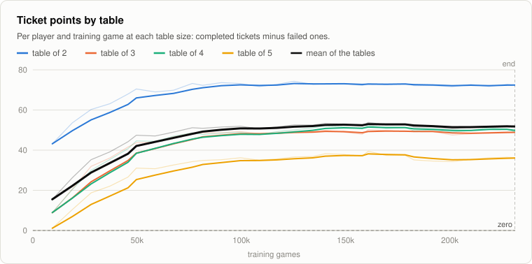

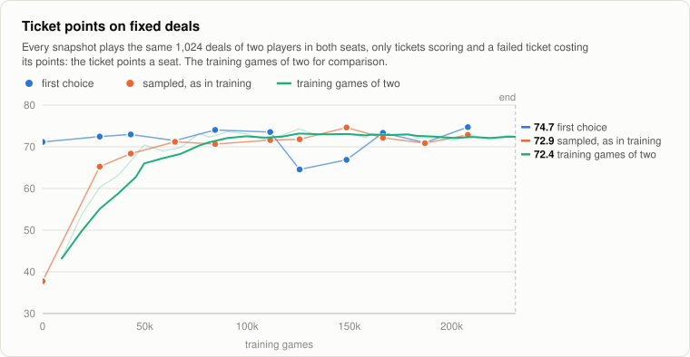

### 4. The full scoring

Routes and the longest trail score again. The price of a route, the share of its points a claim
scores, starts at nothing and rises by a fifth at a time; the phase ends when it is whole. The
network keeps its ticket points while its route points come in.

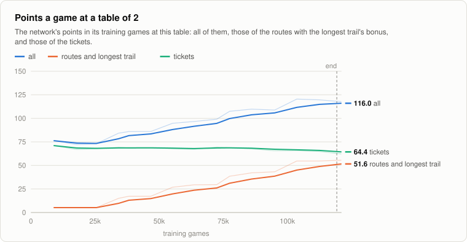

### 5. Beating the scripted bots

Proximal policy optimization with a learned critic, at tables of two to five, against the ticket
builder, the card hoarder and the network of phase 4. Every deal is played once with the network in
each seat, so the luck of the deal cancels. A move's reward is its seat's margin over the strongest
other seat, less the table's mean margin. The phase's goal is its share of first places against the
three, the mean over the tables; the phase ends when the goal stops rising. It rose from 39.5 % to
62.7 %.

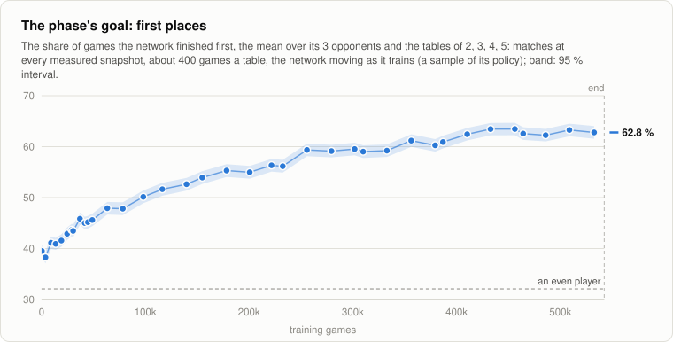

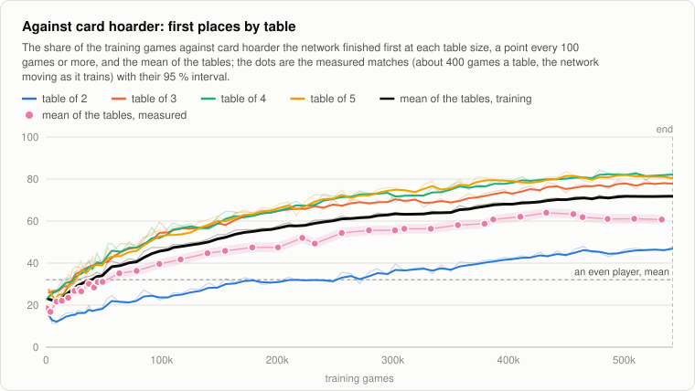

### 6. Beating its ancestors

Against the card hoarder and the ends of phases 4 and 5. The critic's targets are now TD(lambda)
returns, lambda 0.995, so the positions of one game no longer share one target. The phase ends like
phase 5.

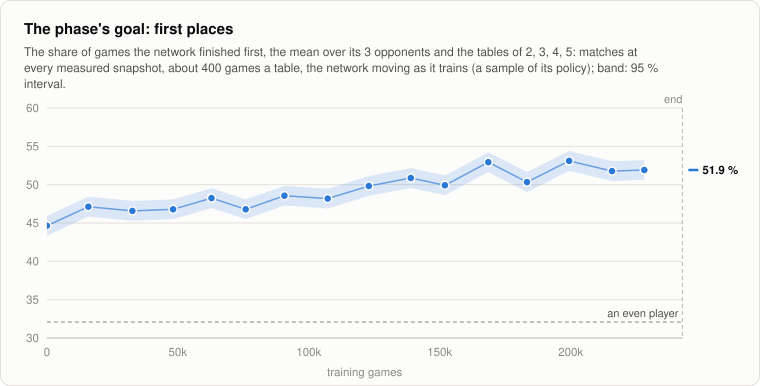

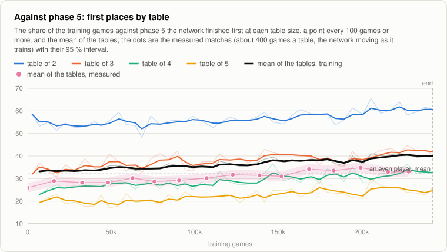

### 7. Beating its ancestors

Against the ends of phases 4, 5 and 6 in equal shares, and no bots.

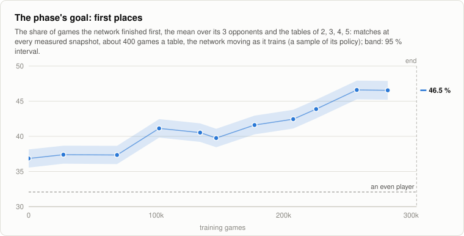

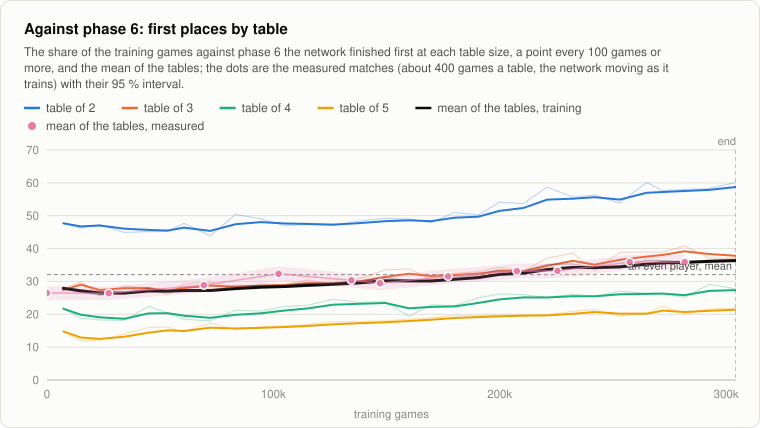

### 8. Scoring high

Against the ends of phases 5, 6 and 7, with a bonus in the reward for the network's own points up to
160 and for its completed tickets up to five. The network scores more. Its share of first places
against its ancestors rises, falls back, and ends a point above where it began.

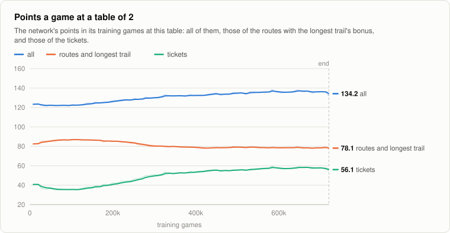

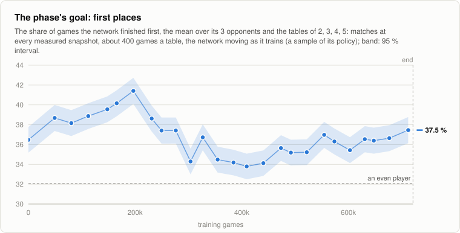

### 9. The championship

Eleven opponents at once: the two bots and nine frozen networks. Within a table an opponent's share
of the games follows (1 - w)^2, where w is the share of games the network wins against it, so that
it meets most the opponents it loses to.

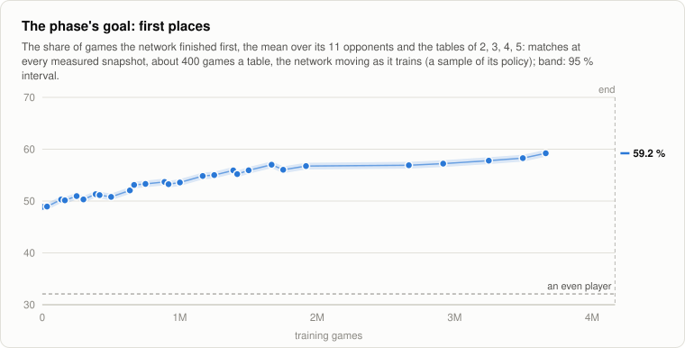

### 10. Seeing further

The championship with a look-ahead teacher. It plays out every choice of tickets and a tenth of the
other decisions at a table of two: the network's first choice and up to three other options, each in
eight worlds with the hidden cards dealt afresh. An option that comes out ahead is played again in
24 fresh worlds and becomes a lesson only if it is still ahead by three points and by two standard
errors. As the network learns the lessons, the look-ahead finds fewer of them.

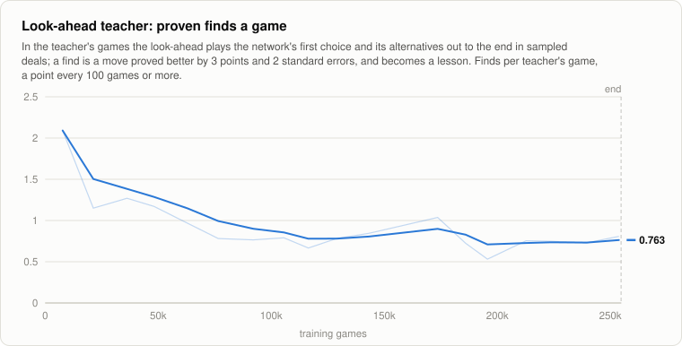

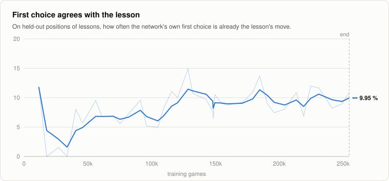

### 11. Real tables

At tables of three to five every other seat is drawn from the league, and the card hoarder sits at
one seat in half of the games. The look-ahead teacher plays against the league too, and a move
forecast trained on its playouts sends the moves it rates well above the first choice straight to
the check.

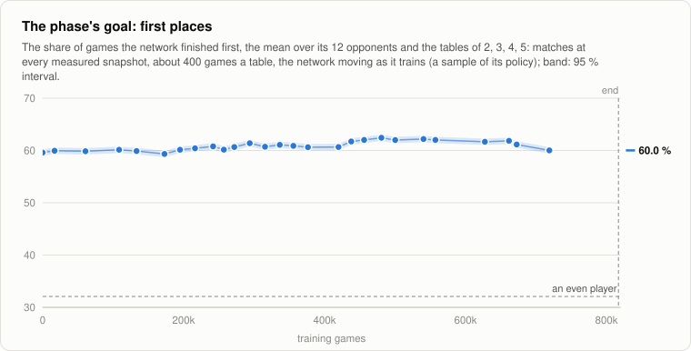

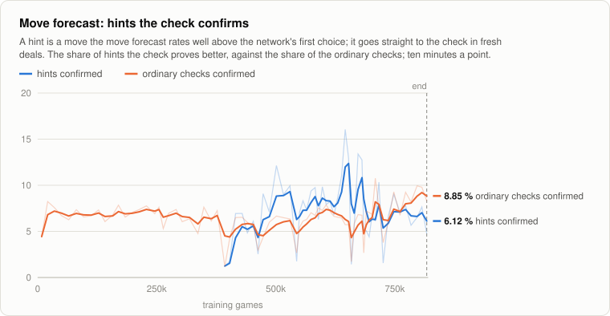

## Ratings

Every phase's end network and the two bots, rated on one Elo scale from duplicate matches at a table
of two: every player against every other, 400 games a pair, each by its first choice, the ticket
builder at 0. The networks of the first three phases played under rules where only tickets score,
so they meet the official rules here for the first time.

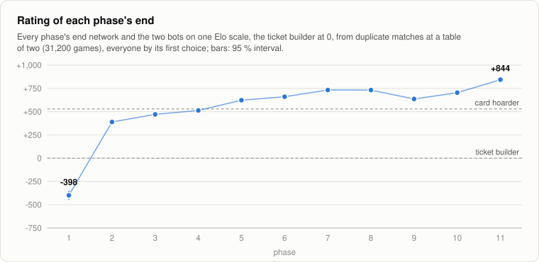

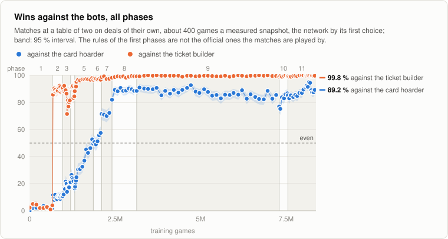

`python -m deepttr.championship runs/one` plays this championship for a run of the recipes.

## Where the recipes differ from that run

- The league of phases 9 to 11 held six networks from outside this line of phases. The recipes use
  only the bots and the ends of the phases before, so their championship has five opponents, and
  six with the end of phase 9 in phases 10 and 11.
- In phases 5 and 6 the frozen networks chose their moves by a search of one simulation valued by
  the score on the board; in the recipes they play their first choice, as they did from phase 7 on.
- Phase 2 ended by a measure of moves chosen by that search, and phases 3 and 7 to 11 ended by
  decision. The recipes train these phases as many steps as they took; phase 11 the 97,894 steps
  its network kept.
- Phase 11 changed its settings seventeen times while it ran and was rolled back once. Its recipe has
  the settings it ended with, and keeps the critic, which the run dropped for its last 19,000 steps.
- The route price of phase 4 rose every 15 minutes; in the recipe it rises every 5,750 steps, so a
  run does not depend on the speed of the machine.
- From phase 5 on a turn that ends with more than fourteen train cards in hand costs its first move
  five points for every card above fourteen, thirty at most. The original run had no such penalty.
